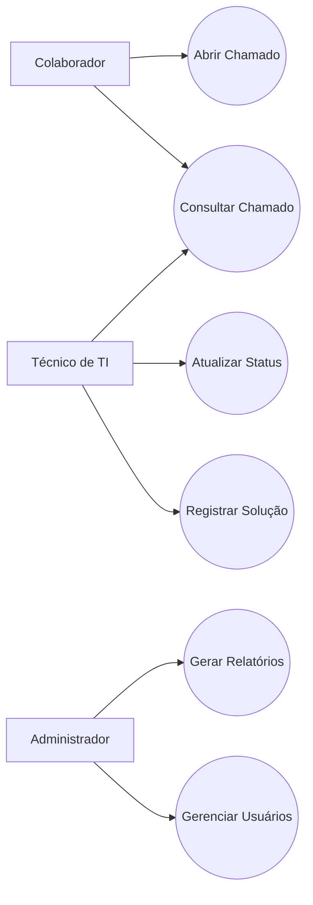
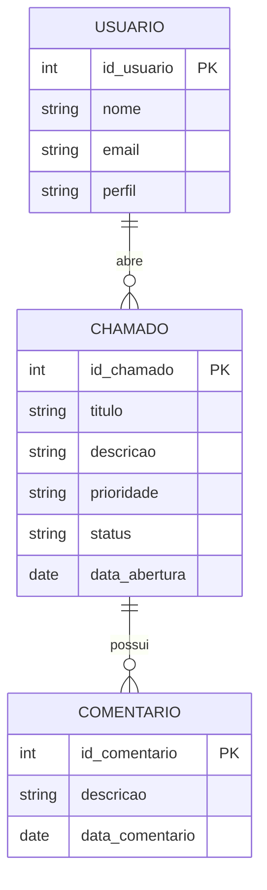

# 📞 Sistema de Chamados de TI (Help Desk)

## 📋 Sobre o Projeto

O Sistema de Chamados de TI foi desenvolvido para registrar, acompanhar e gerenciar solicitações de suporte técnico em organizações.

A solução permite abertura de chamados, acompanhamento de status, atribuição de técnicos, histórico de atendimentos e geração de relatórios gerenciais.

---

## 🎯 Objetivos

- Gerenciar solicitações de suporte.
- Controlar atendimentos.
- Acompanhar indicadores.
- Melhorar a comunicação entre usuários e TI.
- Organizar o histórico de chamados.

---

## 👥 Atores

### Colaborador

- Abrir chamado
- Consultar chamado

### Técnico de TI

- Atender chamado
- Atualizar status
- Registrar solução

### Administrador

- Gerenciar usuários
- Emitir relatórios

---

## ✅ Funcionalidades

- Login
- Abertura de chamados
- Priorização
- Acompanhamento
- Comentários
- Relatórios
- Dashboard

---

## 🏛️ Diagrama de Casos de Uso

---

## 🗄️ Modelo Entidade-Relacionamento (ERD)

